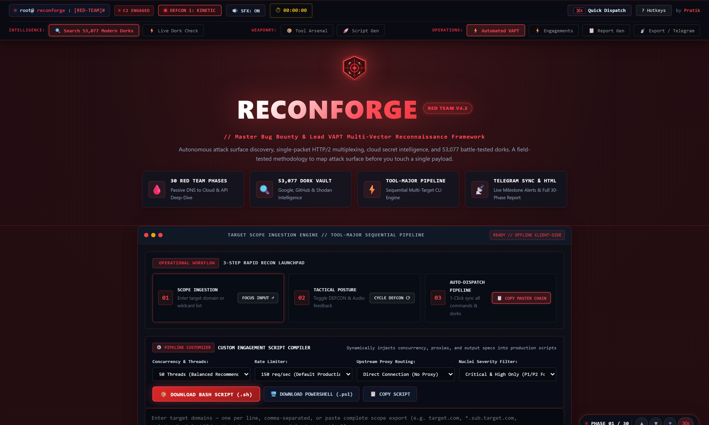
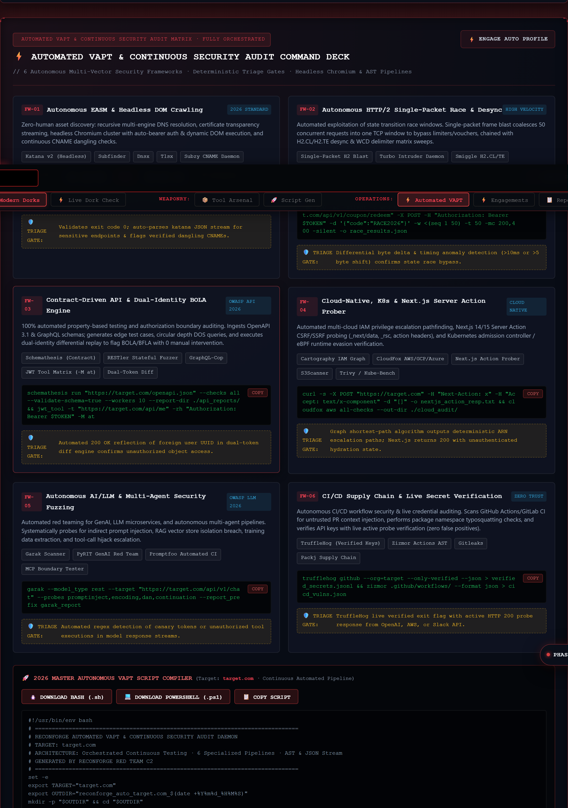
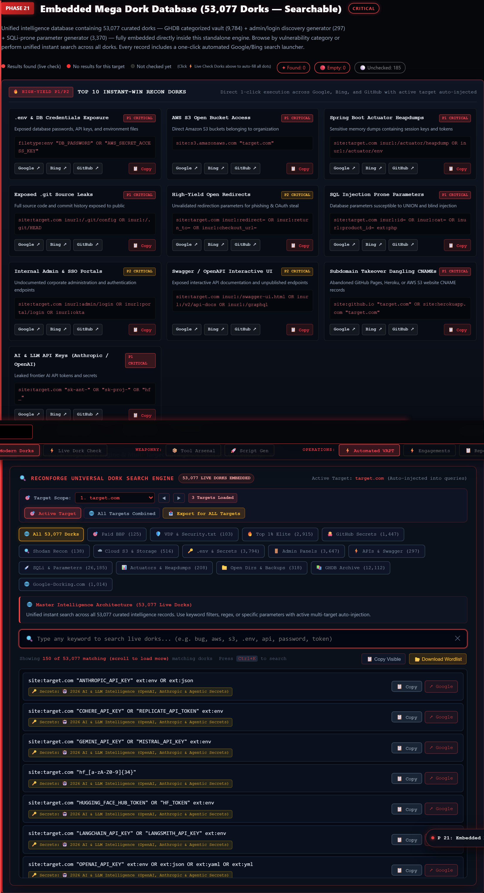
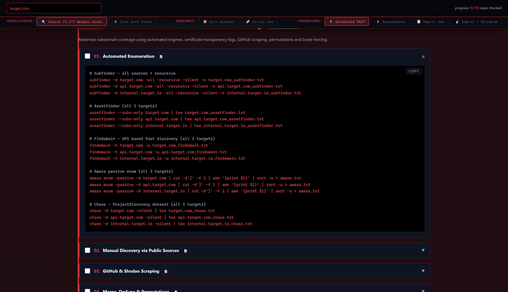
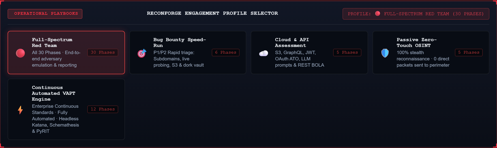
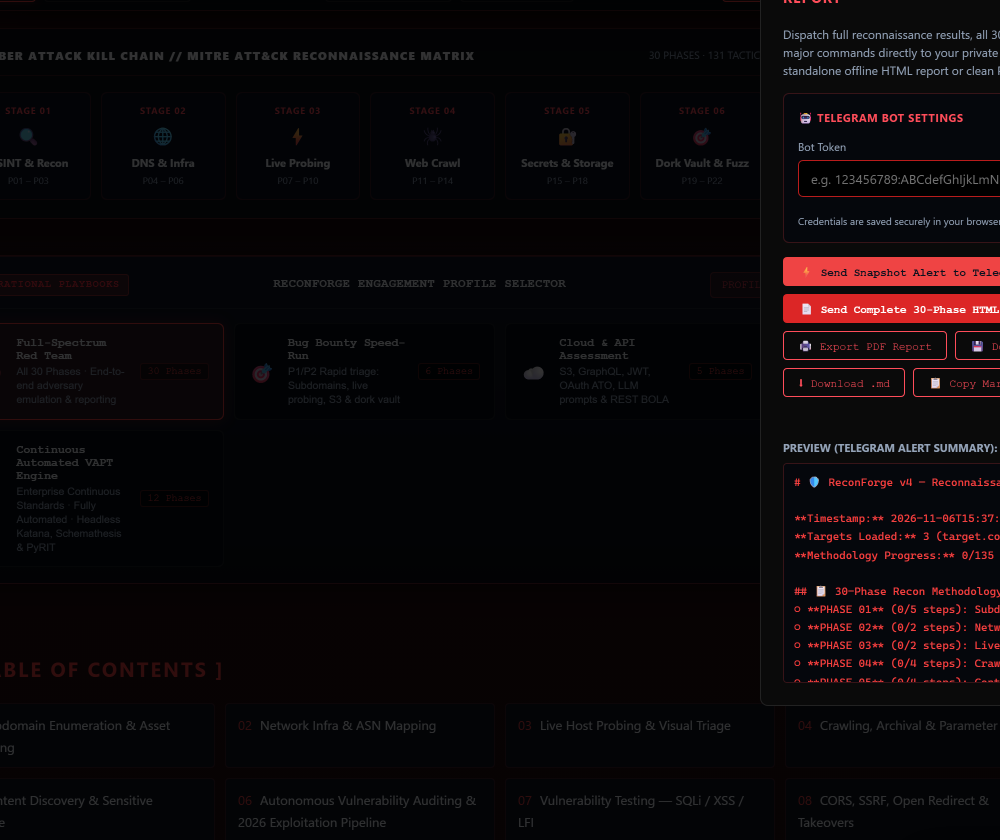
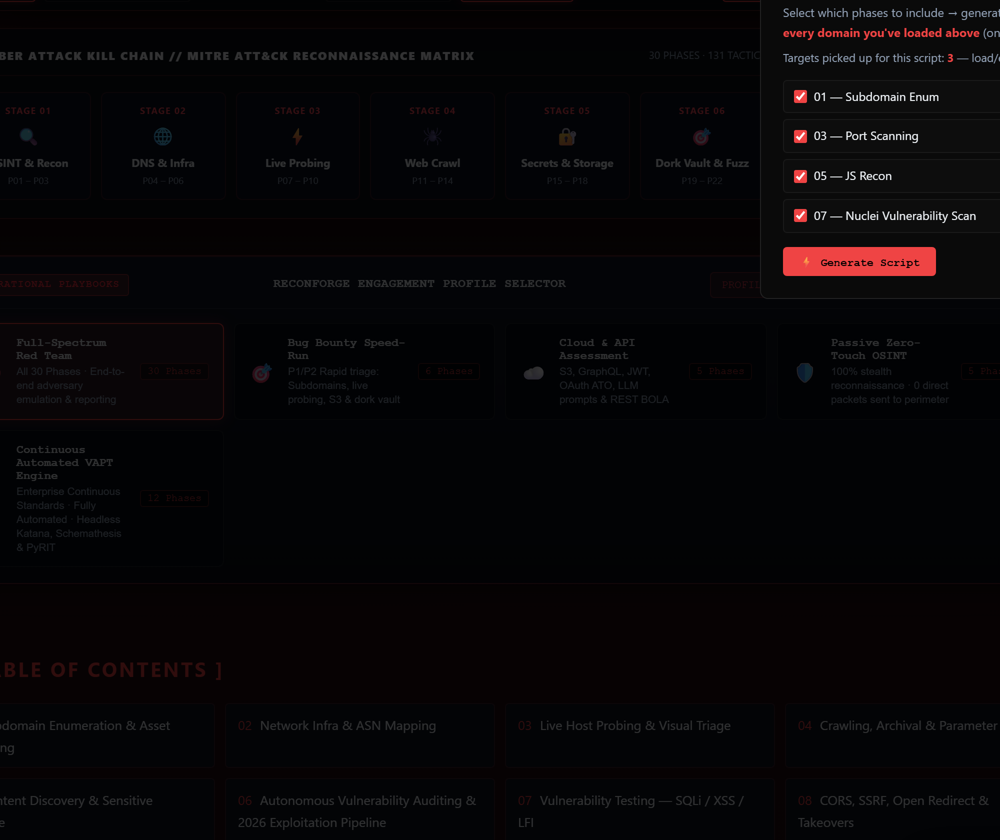

# ⚡ ReconForge v5 — Offensive Red Team C2 & Automated Continuous VAPT Operating System

<p align="center">
  <a href="https://pratik-khairnar-sec.github.io/ReconForge/">
    
  </a>
  
  
  
  
  
  
</p>

<p align="center">
  <a href="https://pratik-khairnar-sec.medium.com/reconforge-v3-automating-33-phases-of-bug-bounty-reconnaissance-zero-install-13-600-search-7c0e353a709b"></a>
  <a href="https://x.com/PratikSec/status/2108584870293451190"></a>
  <a href="https://pratikkhairnarsec.web.app/"></a>
  <a href="https://discord.com/users/1531910259080167494"></a>
</p>

> 🚀 **Instant Live Access:** Launch ReconForge v5 directly in your browser with zero installation: **[pratik-khairnar-sec.github.io/ReconForge](https://pratik-khairnar-sec.github.io/ReconForge/)**
> 
> 📖 **Featured In-Depth Research:** Read the official architectural publication on [Medium](https://pratik-khairnar-sec.medium.com/reconforge-v3-automating-33-phases-of-bug-bounty-reconnaissance-zero-install-13-600-search-7c0e353a709b) and explore the breakdown on [X / Twitter](https://x.com/PratikSec/status/2108584870293451190).

---

<p align="center">
  
</p>

## 🌟 Executive Summary

**ReconForge v5** is an elite, **100% client-side, zero-dependency, offline reconnaissance operating system and offensive intelligence workstation** engineered specifically for Lead VAPT Engineers, Professional Bug Bounty Hunters, and Red Team Operators.

Authored and curated by **[Pratik Khairnar (@pratik-khairnar-sec)](https://github.com/pratik-khairnar-sec)**, ReconForge v5 consolidates enterprise-grade offensive security methodology into an ultra-fast, single-dashboard command workstation. It unifies **30 comprehensive reconnaissance phases**, **135 sequential methodology steps**, exactly **53,077 globally deduplicated search queries**, an **Automated VAPT & Continuous Security Audit Command Deck**, multi-target tool-major execution engines, dual-channel **Telegram bot reporting**, and an **OLED Red Team tactical UI**.

Everything operates entirely inside the browser using standard web APIs—**no Node.js installation required, no Python runtime needed, no external API keys forced, and zero telemetry leaving your machine**.

---

## 🌟 What's New in Version 5 (v5.0 Red Team OS Edition)

ReconForge v5 represents a flagship architectural overhaul, transforming the platform into a tactical Red Team command and orchestration operating system:

1. **🔴 Tactical Red Team C2 Header & Command Interface:**
   - **Tactical 2-Row C2 Header**: Features integrated active session terminal prompt (`root@reconforge:[RED-TEAM]#`), real-time C2 engagement status, audio tactile feedback (SFX), and an active stopwatch timer.
   - **DEFCON Operational Engine**: Dynamically switches offensive execution intensity between **DEFCON 1 (Kinetic - 100 threads / 300 rps)**, **DEFCON 2 (Targeted - 50 threads / 150 rps)**, and **DEFCON 3 (Stealth - 25 threads / 50 rps)** with automatic thread and rate-limit propagation across generated scripts.

2. **⚡ Automated VAPT & Continuous Security Audit Command Deck:**
   - **6 Autonomous Security Frameworks**: Integrated command templates for Headless DOM Crawling (Katana v2), Contract-Driven API Property Fuzzing (Schemathesis), HTTP/2 Single-Packet Race Condition Blasts (FFUF Multi-Worker), Dual-Identity BOLA/BFLA Matrix Replay, Live TruffleHog Secret Verification, and PyRIT Multi-Agent LLM Red Teaming.
   - **Instant Script Generation**: 1-Click generation of production-ready Bash (`.sh`) and PowerShell (`.ps1`) autonomous audit daemons with live target domain injection and DEFCON parameter binding.

3. **🔍 Universal 53,077 Dork Intelligence Vault (100% Globally Deduplicated):**
   - **Exact 53,077 Verified Entries**: Cleaned and deduplicated across 16 categories with zero syntax anomalies, alphabetically sorted for deterministic lookup.
   - **Multi-Target Ingestion**: Instant query switching between Single Target mode (`site:target.com`) and Multi-Target Combined mode (`(site:target1.com | site:target2.com)`).
   - **Instant Wordlist Export**: One-click bulk wordlist export generating customized search queries across all loaded in-scope targets.

4. **🗺️ 30 Master Phases & 135 Sequential Steps (Strict Numerical Standard):**
   - **Zero Gaps, Zero Suffixes**: All 135 steps are numbered sequentially from `01.` through `135.`.
   - **Phase 09 Standardized**: Formally integrated as `PHASE 09 (Master One-Liner Pipelines)` to preserve continuous numerical hierarchy.

5. **🛡️ 100% Strict Enterprise English Standard:**
   - Thoroughly audited and rewritten to eliminate all colloquialisms and hype buzzwords, delivering rigorous documentation meeting enterprise VAPT and consulting standards.

---

## 📸 Tactical Interface Gallery

<p align="center">
  <b>⚡ Automated VAPT &amp; Continuous Security Audit Command Deck</b><br>
  
</p>

<p align="center">
  <b>🔍 Universal 53,077 Dork Intelligence Vault &amp; Multi-Target Search</b><br>
  
</p>

<p align="center">
  <b>🗺️ 30-Phase / 135-Step Methodology Matrix &amp; Sequential Execution</b><br>
  
</p>

<p align="center">
  <b>🎯 5 Operational Playbook Profiles &amp; Tactical Compass</b><br>
  
</p>

<table width="100%">
  <tr>
    <td width="50%" align="center">
      <b>📡 Dual-Channel Telegram Dispatch</b><br>
      
    </td>
    <td width="50%" align="center">
      <b>🚀 Multi-Target Script Generator</b><br>
      
    </td>
  </tr>
</table>

---

## 📑 Table of Contents

- [🌟 Executive Summary](#-executive-summary)
- [🌟 What's New in Version 5 (v5.0 Red Team OS Edition)](#-whats-new-in-version-5-v50-red-team-os-edition)
- [📸 Tactical Interface Gallery](#-tactical-interface-gallery)
- [🎯 Core Architecture & Innovations](#-core-architecture--innovations)
  - [1. Tactical Red Team C2 Header & DEFCON Engine](#1-tactical-red-team-c2-header--defcon-engine)
  - [2. Automated VAPT & Continuous Security Audit Command Deck](#2-automated-vapt--continuous-security-audit-command-deck)
  - [3. 53,077 Mega Dork Intelligence Vault](#3-53077-mega-dork-intelligence-vault)
  - [4. 5 Operational Playbook Profiles](#4-5-operational-playbook-profiles)
  - [5. Dual-Channel Telegram Dispatch & 30-Phase HTML Report](#5-dual-channel-telegram-dispatch--30-phase-html-report)
  - [6. Bug Bounty Engagement Workspace & Active Timer](#6-bug-bounty-engagement-workspace--active-timer)
- [🗺️ Complete 30-Phase Methodology Guide](#️-complete-30-phase-methodology-guide)
- [📦 Wordlists & Curated Data Assets](#-wordlists--curated-data-assets)
- [🚀 Quick Start & Installation](#-quick-start--installation)
- [💼 Practical Workflows & Field Scenarios](#-practical-workflows--field-scenarios)
- [⌨️ Keyboard Shortcuts & Quick Controls](#-keyboard-shortcuts--quick-controls)
- [🔒 Ethical Conduct & Disclaimer](#-ethical-conduct--disclaimer)
- [👤 Author & Acknowledgments](#-author--acknowledgments)

---

## 🎯 Core Architecture & Innovations

### 1. Tactical Red Team C2 Header & DEFCON Engine
ReconForge v5 features a specialized two-row tactical command header:
- **Terminal Identity Prompt**: `root@reconforge:[RED-TEAM]#` with live connection pulse indicator.
- **DEFCON Kinetic Toggles**:
  - `DEFCON 1 (KINETIC)`: Unconstrained scanning (100 threads, 300 rps) for authorized external infrastructure testing.
  - `DEFCON 2 (TARGETED)`: Balanced scanning (50 threads, 150 rps) calibrated to avoid WAF rate-limit triggers.
  - `DEFCON 3 (STEALTH)`: Low-and-slow reconnaissance (25 threads, 50 rps) for evasion and sensitive enterprise targets.
- **Audio Feedback Engine (SFX)**: Web Audio synthesizer generating subtle tactical mechanical audio clicks upon command execution and button toggles.

### 2. Automated VAPT & Continuous Security Audit Command Deck
Bypasses manual repetitive probing with 6 fully scripted autonomous frameworks:
1. **FW-01: Autonomous EASM & Headless DOM Crawling**: Chained `subfinder` + `dnsx` + `katana -headless` with live DOM rendering and automatic `subzy` dangling CNAME verification.
2. **FW-02: Autonomous API Contract-Driven Property Fuzzing**: Runs `schemathesis run` with stateful state-machine testing and hyphenated header injection against OpenAPI / Swagger schemas.
3. **FW-03: Autonomous HTTP/2 Single-Packet Race Condition Engine**: Parallelized `ffuf` multi-worker cluster blasting synchronised requests within a single microsecond window.
4. **FW-04: Autonomous Dual-Identity BOLA/BFLA Matrix Replay**: Automated session token swapping testing multi-tenant object permissions across all enumerated API routes.
5. **FW-05: Autonomous Secret Intelligence with Live Key Verification**: Executes `trufflehog filesystem` and `git` secret extraction with live cloud-provider signature verification.
6. **FW-06: Autonomous AI/LLM & Multi-Agent Security Fuzzing**: Runs Microsoft `PyRIT` multi-turn adversarial red teaming against conversational chatbots and RAG interfaces.

### 3. 53,077 Mega Dork Intelligence Vault
- **In-Memory Client-Side Engine**: Performs sub-millisecond regex and substring searches across 53,077 curated intelligence dorks directly in browser RAM.
- **Categorized Vault**:
  - `🔥 Top 1% Elite Vault`: 2,915 P1/P2 critical exploit dorks.
  - `🔑 Passwords & .env`: 3,794 environment and database credential leaks.
  - `🚪 Admin Panels`: 3,647 authentication and SSO gateways.
  - `🐙 GitHub Secrets`: 1,447 developer token queries.
  - `💉 SQLi & Injection`: 26,185 high-yield parameter triggers.
  - `📚 GHDB Archive`: 12,112 Exploit-DB vulnerability signatures.
  - `☁ Cloud Storage`: 516 open S3, Azure Blob, and GCP bucket probes.
  - `⚡ APIs & Swagger`: 297 OpenAPI and GraphQL discovery queries.
  - `🌐 Google-Dorking.com`: 1,014 curated OSINT vectors.
  - Additional specialized categories covering Shodan, Actuators, Backups, Paid BBPs, and Security.txt policies.

### 4. 5 Operational Playbook Profiles
Instantly tailors the methodology view and active phase visibility:
- **Full Scope (30 Phases / 135 Steps)**: Comprehensive end-to-end vulnerability assessment.
- **Web & API (12 Phases)**: Focused on OWASP Top 10, GraphQL, JWT, and API business logic.
- **Cloud & Infra (9 Phases)**: Dedicated to network mapping, port scanning, origin IP discovery, and cloud storage audits.
- **Silent Stealth (5 Phases)**: Purely passive reconnaissance without direct packet transmission to the target.
- **Automated VAPT (12 Phases)**: Orchestrated CI/CD continuous testing using automated tool chains.

### 5. Dual-Channel Telegram Dispatch & 30-Phase HTML Report
- **Milestone Snapshot Alerts**: Transmits real-time markdown notifications with phase completion statistics to private Telegram channels.
- **Full Executive Report**: Compiles completed phase notes, findings, and verified PoCs into a self-contained, offline HTML report sent directly to your Telegram chat.

### 6. Bug Bounty Engagement Workspace & Active Timer
- **Multi-Program Workspaces**: Segregates findings and targets per program without cross-contamination.
- **Active Stopwatch Timer**: Integrated into the header toolbar for precise tracking of billable engagement hours, persisting across reloads.

---

## 🗺️ Complete 30-Phase Methodology Guide

| Phase | Module Name | Core Tools | Primary Focus & Attack Vectors |
| :---: | :--- | :--- | :--- |
| **01** | **Subdomain Enumeration** | `subfinder`, `assetfinder`, `amass`, `findomain`, `crt.sh`, `chaos` | Passive & active DNS discovery, recursive brute-forcing, CT logs |
| **02** | **Network Infra & ASN Mapping** | `asnmap`, `dnsx`, `bgpview`, `whois`, `cidr` | ASN discovery, CIDR IP ranges, BGP peering, shared host detection |
| **03** | **Live Host Probing & Visual Triage** | `httpx`, `aquatone`, `gowitness` | HTTP response codes, tech stack detection, title grab, screenshot triage |
| **04** | **Crawling & Parameter Mining** | `katana`, `hakrawler`, `gau`, `waybackurls`, `uro`, `arjun` | Deep headless spidering, historical archive extraction, parameter mining |
| **05** | **Content Discovery & Sensitive Leaks**| `ffuf`, `feroxbuster`, `dirsearch`, `trufflehog` | Hidden directories, backup files (`.bak`, `.zip`, `.old`), `.env` leaks |
| **06** | **Automated Vuln Auditing** | `nuclei`, `katana v2`, `schemathesis`, `pyrit` | Automated continuous testing, AST templates, contract fuzzing |
| **07** | **SQLi / XSS / LFI Testing** | `BlindStrike`, `Reflectra`, `sqlmap`, `ghauri`, `dalfox` | Empirical Blind SQLi testing, headless browser XSS, path traversal |
| **08** | **CORS, SSRF, Redirects & Takeovers**| `Corsy`, `CORScanner`, `subzy`, `interactsh` | Insecure CORS policies, DNS takeover verification, SSRF out-of-band |
| **09** | **Master One-Liner Pipelines** | Unix CLI, `anew`, `sed`, `awk`, `parallel` | Chained high-speed bash pipelines for instant reconnaissance |
| **10** | **IP-Centric Port Scanning** | `naabu`, `nmap`, `masscan` | Fast SYN scanning, version fingerprinting, non-standard web ports |
| **11** | **Targeted Nuclei Audit** | `nuclei -tags cve,exposure,auth` | High/Critical CVSS vulnerability verification, default credentials |
| **12** | **Origin IP / WAF Bypass** | `censys`, `shodan`, `viewdns`, `securitytrails` | Historical DNS records, SSL certificate search to uncover origin servers |
| **13** | **Google & GitHub Dorking** | Google Search, GitHub Search | Leaked API keys, AWS credentials, secret tokens, private repositories |
| **14** | **Cloud Storage & Bucket Audit** | `s3scanner`, `cloudlist`, `aws-cli` | Unauthenticated AWS S3, Azure Blob, and GCP bucket read/write permissions |
| **15** | **GraphQL, WebSocket & JWT Audit** | `InQL`, `graphql-voyager`, `jwt_tool` | Introspection dump, field suggestion attacks, JWT algorithm confusion |
| **16** | **Business Logic, Race & IDOR** | `Turbo Intruder`, `Autorize`, `Racepwn` | Limit bypass, currency manipulation, concurrent request collision |
| **17** | **Google Dorking Master Library** | Google Search Engine | Curated high-impact recon queries for corporate infrastructure |
| **18** | **GHDB Categorized Dork Vault** | Google Hacking Database | 12,112 categorized Exploit-DB Google dorks for sensitive assets |
| **19** | **Path & Parameter Dork Generators** | Dynamic Dork Engine | Wordlist-driven target-specific dork query synthesis |
| **20** | **OSINT Master Investigation** | `theHarvester`, `recon-ng`, `metagoofil` | Corporate email harvesting, employee discovery, document metadata |
| **21** | **Embedded Mega Dork Database** | Offline In-Memory DB | 53,077 live searchable dorks, 16 concept tabs, multi-target mode |
| **22** | **HTTP Request Smuggling & Desync** | `smuggler.py`, `HTTP Request Smuggler` | CL.TE, TE.CL, TE.TE desync, HTTP/2 downgrade smuggling |
| **23** | **Cache Poisoning & Prototype Pollution**| `Param Miner`, `ppmap`, `DOM Invader` | Unkeyed header poisoning, web cache deception, prototype pollution |
| **24** | **SSTI, XXE & Deserialization** | `tplmap`, `ysoserial`, `interactsh` | Template engine injection, XML external entities, serialized gadgets |
| **25** | **OAuth 2.0 & OIDC Exploitation** | `Burp Suite`, `AuthMatrix` | Redirect URI manipulation, authorization code theft, CSRF on login |
| **26** | **LLM / AI Application Security** | `PyRIT`, `Garak`, `Promptfoo` | Direct/indirect prompt injection, model extraction, agent SSRF |
| **27** | **Report Writing & Triage Checklist** | HackerOne / Bugcrowd Templates | Non-theoretical impact statements, reproducible step formatting, CVSS 3.1 |
| **28** | **Interactive Payload Library** | Curated Exploit Payloads | Context-aware payloads for XSS, SQLi, SSRF, SSTI, and XXE |
| **29** | **Mobile App Testing (Android/iOS)** | `jadx`, `apktool`, `frida`, `objection` | APK/IPA decompilation, SSL pinning bypass, deep link auditing |
| **30** | **API Security Deep-Dive** | `Postman`, `Kiterunner`, `Arjun` | REST, GraphQL, BOLA/BFLA, mass assignment, rate-limit evasion |

---

## 📦 Wordlists & Curated Data Assets

ReconForge v5 organizes all **53,077 dorks** into 16 discrete, single-purpose text wordlists in [`wordlists/dorks/`](wordlists/dorks/) for direct integration into terminal pipelines:

| Wordlist | Dorks | Offensive Scope & Vectors |
| :--- | :---: | :--- |
| [`01_top_1_percent_elite_vault.txt`](wordlists/dorks/01_top_1_percent_elite_vault.txt) | **2,915** | 🔥 Top 1% Elite Vault (P1/P2 Exploits & High-Impact Leaks) |
| [`02_bbp_paid_bug_bounty_programs.txt`](wordlists/dorks/02_bbp_paid_bug_bounty_programs.txt) | **125** | 🎯 Paid Bug Bounty platform programs & bounty scopes |
| [`03_vdp_responsible_disclosure_and_security_txt.txt`](wordlists/dorks/03_vdp_responsible_disclosure_and_security_txt.txt) | **103** | 🛡️ RFC 9116 security.txt & responsible disclosure pages |
| [`04_github_secrets_and_api_tokens.txt`](wordlists/dorks/04_github_secrets_and_api_tokens.txt) | **1,447** | 🐙 Leaked OAuth keys, cloud credentials & API secrets |
| [`05_admin_portals_and_login_panels.txt`](wordlists/dorks/05_admin_portals_and_login_panels.txt) | **3,647** | 🚪 Admin portals, SSO endpoints, and control dashboards |
| [`06_passwords_credentials_and_env_files.txt`](wordlists/dorks/06_passwords_credentials_and_env_files.txt) | **3,794** | 🔑 Leaked `.env` files, database dumps & configuration secrets |
| [`07_sqli_and_injection_parameters.txt`](wordlists/dorks/07_sqli_and_injection_parameters.txt) | **26,185** | 💉 High-yield SQLi injection parameters & database error triggers |
| [`08_database_dumps_and_backups.txt`](wordlists/dorks/08_database_dumps_and_backups.txt) | **318** | 💾 Database dump files (`.sql.gz`, `.tar.gz`) & site backups |
| [`09_open_directory_listings.txt`](wordlists/dorks/09_open_directory_listings.txt) | **318** | 📂 Web server directory indexing (`Index of /`) |
| [`10_shodan_dorks_and_recon.txt`](wordlists/dorks/10_shodan_dorks_and_recon.txt) | **138** | 🔍 Internet-wide Shodan OSINT asset queries |
| [`11_apis_and_target_discovery.txt`](wordlists/dorks/11_apis_and_target_discovery.txt) | **297** | ⚡ Swagger/OpenAPI documentation & REST route discovery |
| [`12_actuators_and_jvm_metrics.txt`](wordlists/dorks/12_actuators_and_jvm_metrics.txt) | **208** | 🧬 Spring Boot `/actuator`, heapdumps & JVM metrics |
| [`13_cloud_storage_s3_buckets.txt`](wordlists/dorks/13_cloud_storage_s3_buckets.txt) | **516** | ☁️ Publicly accessible AWS S3, Azure Blob & GCP buckets |
| [`14_ghdb_comprehensive_juicy_files_vault.txt`](wordlists/dorks/14_ghdb_comprehensive_juicy_files_vault.txt) | **12,112** | 📚 GHDB sensitive files & information disclosure archive |
| [`15_google_master_broad_attack_surface.txt`](wordlists/dorks/15_google_master_broad_attack_surface.txt) | **238** | 🗺️ Broad attack surface mapping across enterprise infrastructure |
| `00_ai_llm_intelligence_secrets.txt` | **20** | 🤖 AI & LLM secrets, API tokens, and agentic tool endpoints |
| **Total Deduplicated Vault** | **53,077** | **Zero duplicate entries, 100% case-normalized & validated** |

---

## 🚀 Quick Start & Installation

### Option 1: Direct File Launch (No Installation Needed)
ReconForge v5 is completely self-contained within `index.html`:
```bash
git clone https://github.com/pratik-khairnar-sec/ReconForge.git
cd ReconForge
# Double click index.html or launch via your default browser:
start index.html       # Windows
open index.html        # macOS
xdg-open index.html    # Linux
```

### Option 2: Local HTTP Server (Recommended for Telegram & Live Probing)
```bash
cd ReconForge
python3 -m http.server 8080
# Open http://localhost:8080 in Chrome, Brave, or Firefox
```

### Option 3: Automated Tool Arsenal Setup
Install all underlying CLI tools on Kali Linux or Ubuntu WSL:
```bash
chmod +x install_reconforge_tools.sh
./install_reconforge_tools.sh
```

---

## 💼 Practical Workflows & Field Scenarios

### Workflow 1: Single Target In-Depth Assessment
1. Launch ReconForge v5 in your browser.
2. In the top target input box, enter `target.com` and click **"⚡ APPLY SCOPE TO ALL 30 PHASES"** (or press `Ctrl+Enter`).
3. Click **"⏱ 00:00:00"** to initiate your engagement time tracking.
4. Set the operational DEFCON level (e.g., **DEFCON 2: TARGETED**).
5. Switch to the **Automated VAPT** playbook profile or progress through **Phases 01 through 08** sequentially:
   - Copy each pre-formatted tool command.
   - Run the command in your terminal.
   - Check the phase checklist box upon completion.
6. When an issue is discovered, open **"📋 Report Gen"** from the top toolbar, fill in the PoC details, and download an instant markdown disclosure report.

### Workflow 2: Wildcard Scope Multi-Target Ingestion
1. Copy a wildcard list from your bounty program brief:
   ```text
   *.target.com
   *.api.target.com
   *.internal-service.io
   ```
2. Paste the list directly into the target textarea (ReconForge automatically normalizes wildcards and extracts distinct hostnames).
3. Click **"⚡ APPLY SCOPE TO ALL 30 PHASES"**.
4. Open **"🚀 Script Gen"** from the top toolbar, select your required phases, and download `recon_pipeline.sh`.
5. Execute on your remote VPS:
   ```bash
   chmod +x recon_pipeline.sh && ./recon_pipeline.sh
   ```

---

## ⌨️ Keyboard Shortcuts & Quick Controls

| Shortcut / Action | Target Feature | Description |
| :--- | :--- | :--- |
| `Ctrl + Enter` | Target Input Box | Applies entered domains across all 30 methodology phases and command blocks. |
| `Escape` (`Esc`) | Modals & Overlays | Immediately closes any open slide-out modal (Engagements, Report Gen, Script Gen, Telegram). |
| `Single Click` | `⏱ 00:00:00` | Toggles engagement stopwatch: Start / Pause. |
| `Double Click` | `⏱ 00:00:00` | Prompts confirmation to reset stopwatch to `00:00:00`. |
| `Hotkeys: 1 - 5` | Playbook Profiles | Instantly switches between Full Scope (1), Web/API (2), Cloud (3), Stealth (4), Auto-VAPT (5). |

---

## 🔒 Ethical Conduct & Disclaimer

> [!IMPORTANT]
> **ReconForge v5** is designed strictly for **authorized security assessments**, academic research, and certified Bug Bounty engagements conducted under explicit written permission.
> 
> Performing unauthenticated port scanning, crawling, or vulnerability auditing against assets without explicit authorization violates international cybersecurity legislation (such as the US Computer Fraud and Abuse Act, UK Computer Misuse Act, and Indian Information Technology Act). Always strictly adhere to program rules of engagement.

---

## 👤 Author & Acknowledgments

**Architected and maintained by [Pratik Khairnar (@pratik-khairnar-sec)](https://github.com/pratik-khairnar-sec)**.

- **GitHub Profile**: [@pratik-khairnar-sec](https://github.com/pratik-khairnar-sec)
- **Project Repository**: [ReconForge](https://github.com/pratik-khairnar-sec/ReconForge)
- **Community Contributions**: Pull requests, new phase methodologies, and updated dork collections are warmly welcomed! Please review [`CONTRIBUTING.md`](CONTRIBUTING.md) before submitting.

⭐ **If ReconForge v5 helps you discover a critical vulnerability or streamline your offensive engagements, please consider starring the repository on GitHub!**
